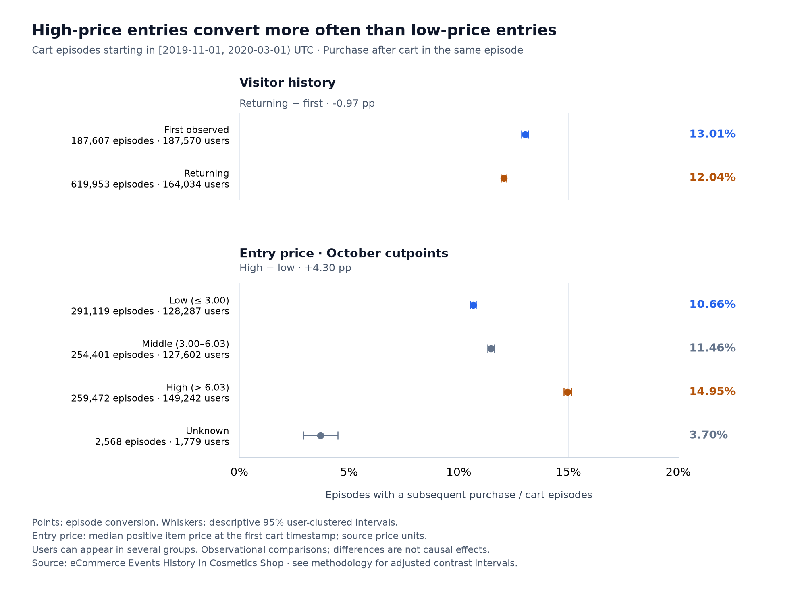

# From Cart to Repeat Purchase

Product analytics of a cosmetics store: purchase funnel, cart abandonment, and repeat purchases around Black Friday 2019.

**Funnel result (October–February):** 122,189 of 1,049,303 observed cart episodes contain a subsequent purchase: **11.64%**. Cart abandonment is measured within the observed episode; purchases can occur in later episodes.

**Status: work in progress.** Event staging, 30-minute episodes, ordered session/user funnels, and user-clustered segment comparisons are built and validated. Repeat-purchase cohorts, business recommendations, and the dashboard are pending.

## Business question

Where does the observed purchase journey break down, which customer segments deserve investigation, and which product improvement should be tested first?

A second question examines whether customers whose first observed purchase occurred during Black Friday week make repeat purchases at different rates from nearby weekly cohorts over the same 30- and 60-day horizons.

## Planned analysis

- Validate event coverage, duplicates, prices, and session identifiers.
- Build an ordered view → cart → purchase funnel and compare cart abandonment across customer and price segments.
- Measure repeat purchases using complete follow-up windows.
- Estimate incremental revenue under explicit conversion scenarios and design an A/B test for one prioritized hypothesis.
- Present the results in a reproducible Metabase dashboard and a short decision memo.

## Data

[eCommerce Events History in Cosmetics Shop](https://www.kaggle.com/datasets/mkechinov/ecommerce-events-history-in-cosmetics-shop), published by Michael Kechinov / REES46 on Kaggle. The five source files cover October 2019–February 2020, as verified during the input audit. Dataset terms remain those specified by the publisher on Kaggle.

Raw data is not included in this repository. The event schema has no order ID, confirmed item quantity, acquisition cost, or cost of goods. Purchase sessions will therefore be treated as order proxies, subject to validation. Abandoned-cart value is not equivalent to recoverable revenue, and observational cohort differences do not establish a causal promotion effect.

## Ordered funnel

The primary unit is an episode within `(user_id, user_session)`, split at inactivity gaps **greater than 30 minutes** across all files. There are 4,810,579 episodes. Equal timestamps are allowed in the primary sequence; strict ordering is a sensitivity check.

| Ordered stage | Episodes | Conversion from the previous stage |
|---|---:|---:|
| Recorded view | 4,501,112 | — |
| Cart at/after a view | 745,696 | 16.57% |
| Purchase at/after that cart | 95,850 | 12.85% |

Across **all** 1,049,303 episodes with a cart, 122,189 have a purchase at/after the first cart (**11.64%**). The remaining 927,114 (**88.36%**) have no such purchase within the observed episode. This denominator includes cart episodes without a qualifying view and differs from the ordered-funnel denominator above.

There are 157,595 purchase-containing episodes in total. Of these, 61,745 (**39.18%**) lack a complete recorded view → cart → purchase chain. Full-funnel completion therefore does not cover all purchasing activity. Strict timestamp ordering yields 95,808 full chains, 42 fewer than the primary rule. Without the 30-minute split, cart-to-purchase conversion is 12.73%, versus 11.64% with the selected episodes; the unit definition changes the estimate.

The analysis includes all observed eligible episodes. At the end of the dataset, 176 episodes may still be open, including 49 counted as abandoned-cart episodes. Abandonment is an observed sequence outcome, not a monetary-loss estimate or a causal explanation.

## Validation

All 20,692,840 source rows remain in staging, with duplicate and quality flags. Events occur on all 152 calendar days from October 1, 2019 to February 29, 2020. The 4,598 events without session identifiers remain in staging and are excluded from episode calculations; none are purchases. Positive purchase-event prices reconcile to 6,351,830.29 source units under both session definitions.

The audit found 1,109,098 excess exact-row copies; only 905 are purchases. Their removal changes the positive purchase-price sum by 0.0561%, reported as sensitivity. Missing brands, category labels, nonpositive prices, and long-lived source tokens are documented in the [methodology](docs/methodology.md).

## Seven-day user funnel

Each user enters at their first observed view across the complete source history. The primary entry cohort starts on **November 1, 2019**, after the October reference period. Outcomes can span sessions, up to and including seven days after entry. Only users with a fully observable deadline enter the denominator; earlier users do not re-enter at a later view.

| Ordered stage | Users | Conversion from the previous stage |
|---|---:|---:|
| First observed view with complete follow-up | 1,140,964 | — |
| Cart within the seven-day window | 169,884 | 14.89% |
| Purchase after that cart, within the same window | 49,385 | 29.07% |

There are 68,459 users whose first-view window is incomplete and 41,604 observed users without a view; neither group is counted as a failed funnel conversion. The result describes the first observed view cohort, not confirmed new customers. Its population, unit, and horizon differ from the episode funnel, so the conversion rates do not measure a causal benefit of a longer window.

Overall seven-day view-to-purchase conversion is **4.33%**. The separate full-history sensitivity includes 1,529,295 mature users and 68,921 full chains (4.51%); the October entry population accounts for the difference.

## Cart conversion by segment

For **807,560 cart episodes starting in November–February**, 99,078 contain a subsequent purchase. Visitor status uses the user's past observed activity, including October. Entry price uses positive prices of unique products at the first cart timestamp; October-only terciles fix the boundaries at **3.00** and **6.03** source units. Missing positive entry prices remain a separate Unknown group.



The two planned comparisons use user-clustered analytical intervals, retaining covariance when the same user appears in both groups. Bonferroni correction covers the two comparisons together at family alpha 0.05.

| Planned comparison | Difference | Adjusted contrast interval (97.5%) |
|---|---:|---:|
| Returning minus first observed | −0.97 pp | [−1.19, −0.75] pp |
| High minus low entry price | +4.30 pp | [+4.07, +4.53] pp |

These associations identify questions to investigate; they do not show that raising prices improves conversion or explain why returning visitors convert less often. Group user counts overlap. The 52 potentially open cart episodes remain included. See the [methodology](docs/methodology.md#segments-and-statistical-comparisons) for estimands, price rules, uncertainty assumptions, and limits.

## Stack

Current: Python 3.12, uv, DuckDB, NumPy/SciPy for clustered comparisons, and matplotlib for exported figures. Dependency versions are recorded in `uv.lock`.

Planned: PostgreSQL and Metabase/Docker Compose for reporting.

## Documentation

- [Methodology and metric definitions](docs/methodology.md)

## Reproduction

Install uv and run the following commands from the repository root. Manual environment activation is not required.

```powershell
uv sync --locked
uv run --locked python -m unittest discover -s tests -v
```

Download the dataset from Kaggle using **Download** (sign in if required). Create the local input directory and extract the five CSV files directly into it:

```powershell
New-Item -ItemType Directory -Force -Path data/raw
```

```text
data/raw/
  2019-Oct.csv
  2019-Nov.csv
  2019-Dec.csv
  2020-Jan.csv
  2020-Feb.csv
```

The extracted files total approximately 2.43 GB according to Kaggle file metadata. Do not rename the files or place them inside an additional archive subfolder. Raw data, local reports, credentials, and database files are excluded from version control.

After extraction, run the single-file audit:

```powershell
uv run --locked python src/audit_data.py --input data/raw/2019-Oct.csv
```

The audit checks the header, counts every parsed row, reports event types, UTC timestamp bounds and daily coverage, missing fields, invalid timestamps/prices, zero and negative prices, and unexpected event types. It records the input SHA-256, file size, and runtime versions in `data/reports/2019-Oct_audit.json`. CSV structure errors stop the audit instead of silently skipping rows.

To reproduce the full five-file audit, including duplicate sensitivity:

```powershell
foreach ($month in @('2019-Oct', '2019-Nov', '2019-Dec', '2020-Jan', '2020-Feb')) {
    uv run --locked python src/audit_data.py --input "data/raw/$month.csv" --duplicates
    if ($LASTEXITCODE -ne 0) { throw "Audit failed: $month" }
}
```

All source columns are initially read as strings; parsing failures are counted separately. Exact duplicates match all nine original fields, excluding file metadata. `--duplicates` adds a read-only sensitivity calculation; it does not remove any rows. Larger groupings may use temporary disk space in `data/processed/audit_tmp/` under the 1 GB DuckDB memory limit. All five files were audited; detailed JSON reports remain local. This is the audit step, not the complete analytical pipeline.

Build staging, then episodes and funnels:

```powershell
uv run --locked python src/build_staging.py
uv run --locked python src/build_funnel.py
uv run --locked python src/build_analysis.py
uv run --locked python src/plot_segments.py
```

These commands populate `data/processed/shop.duckdb`; local reports are `data/reports/staging_build.json`, `data/reports/funnel_build.json`, and `data/reports/user_analysis.json`. The last command exports the figure above from the validated analysis report. The builds use validated transactions and record input provenance or staging/table fingerprints. The default memory limit is 1 GB with two worker threads; temporary files stay in `data/processed/shop_tmp/`. A successful staging rebuild invalidates downstream funnel/user/segment tables; a funnel rebuild invalidates cart segments. Rerun downstream analysis and the chart after either rebuild.

The analysis parameters are in `config/analysis.toml`. `episode_events` maps eligible source records to episodes; `episodes` is the primary per-episode view; `session_funnel` stores per-unit results for both session definitions; `funnel_summary` contains counts and rates for both timestamp rules. The original `sessions` table remains the source-key diagnostic baseline.

`users` retains observed activity history even when session keys are missing. `user_funnel` stores fixed-window outcomes and eligibility flags; `user_funnel_summary` separates timestamp rules and entry populations. `cart_entry_prices` and `price_thresholds` establish entry prices and reference-only cutpoints; `cart_segments` stores episode classifications, `cart_segment_users` supplies cluster counts, and `cart_segment_summary` contains reconciled group totals. Statistical estimates and planned contrasts are saved in the analysis JSON report.

All builders have run on the full dataset. The 40 tests cover repeat builds, boundaries, sequence order, rollback, frozen price calibration, and shared-user covariance against hand-computed examples.
