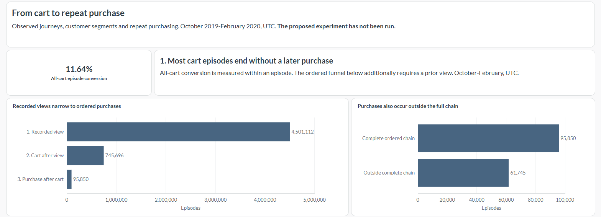
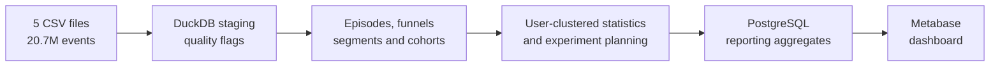

# Online Store Analytics: Where Does the Purchase Journey Break?


A cosmetics store records views, cart actions, and purchases, but those events do not explain why customers leave. This project uses **20.7 million events from October 2019 to February 2020** to examine purchase journeys and repeat buying, then plan a product experiment.

## TL;DR

| Question | Observed result |
|---|---|
| How often does a cart episode lead to purchase? | **11.64%**: 122,189 of 1,049,303 cart episodes |
| Which price segment converts more often? | High entry price: **14.95%**, versus **10.66%** for Low |
| Do Black Friday week buyers return? | **17.97%** repeat within 60 days, versus **21.04% / 18.76%** in the preceding weeks and **16.68%** in the following week |

**Recommended next step:** investigate cost and fulfillment uncertainty, then test showing that information in the cart. At an assumed +1 percentage-point uplift, a conditional scenario gives **3,965.74 additional positive purchase-event price units per 10,000 eligible users**. This is planning arithmetic, not observed uplift, revenue, or profit; no experiment has been run.



*Local Metabase dashboard. Episode conversion leads the page; cohort outcomes and experiment planning are grouped separately.*

## Key findings

- **The full funnel misses part of the recorded purchasing activity.** Of 157,595 purchase-containing episodes, 61,745 lack a complete view → cart → purchase chain. Report purchase coverage alongside funnel conversion; missing steps alone do not establish tracking faults or customer motives.
- **Segment differences are measurable, but observational.** High-price cart episodes convert 4.30 pp more often than Low; returning episodes convert 0.97 pp less often than first-observed episodes. These differences do not show that raising prices improves conversion or explain why returning visitors leave.
- **BF-week repeats trail the preceding November cohorts, but exceed the next week.** Equal, complete follow-up makes the comparison interpretable. Unknown promotion exposure, customer mix, and seasonality prevent a causal promotion-effect or ROI claim.
- **The proposed experiment fits a four-week historical traffic budget.** Detecting +1 pp requires 30,643 users per arm and a complete seven-day outcome window. This is a resource-based design; actual future traffic and economic viability still need validation.

## Approach



### 1. Data audit and SQL marts

The [REES46 / Michael Kechinov dataset](https://www.kaggle.com/datasets/mkechinov/ecommerce-events-history-in-cosmetics-shop) contains **20,692,840 events across 152 calendar days**. Raw files remain unchanged and are not redistributed.

All rows are retained with quality and duplicate flags. Removing exact purchase copies changes the positive purchase-price sum by **0.0561%**; without quantity, identical purchase rows cannot reliably be classified as tracking errors. Nonpositive prices remain in behavioral outcomes but do not contribute to positive value sums.

Some source session keys span days or months. The main unit therefore splits each `(user_id, user_session)` group at inactivity gaps **greater than 30 minutes**, across all files. Original keys remain a sensitivity baseline. SQL lives in [`sql/`](sql/); definitions and checks are in the [methodology](docs/methodology.md).

### 2. Ordered funnel and purchase coverage

The main funnel searches for view → cart → purchase in chronological order, allowing equal timestamps. Steps may involve different products. Strict ordering is a sensitivity check.

| Ordered stage, October–February | Episodes | Conversion from previous stage |
|---|---:|---:|
| Recorded view | 4,501,112 | — |
| Cart at/after a view | 745,696 | 16.57% |
| Purchase at/after that cart | 95,850 | 12.85% |

The **11.64% all-cart conversion** uses a broader denominator: every cart episode, including those without a prior view. Cart abandonment is measured within the observed episode; the customer may buy in a later episode.

A separate seven-day first-view user funnel is also implemented. It allows transitions across episodes and has a different entry population from the post-cart baseline used for experiment planning.

### 3. Cart segments and statistical comparisons

The analysis covers **807,560 cart episodes entering November–February**. Visitor status uses past observed activity, including October. Entry price uses positive prices of unique products at the first cart timestamp. October-only terciles freeze the boundaries at **3.00** and **6.03** source units; unavailable positive prices remain Unknown.

| Prespecified comparison | Conversion rates | Difference | Adjusted 97.5% interval |
|---|---|---:|---:|
| Returning − first observed | 12.04% vs 13.01% | −0.97 pp | [−1.19, −0.75] pp |
| High − low entry price | 14.95% vs 10.66% | +4.30 pp | [+4.07, +4.53] pp |


Repeated episodes from one user are not independent. Analytical user-clustered intervals retain covariance for users in both groups; Bonferroni correction covers the two planned contrasts. The figure shows descriptive **95% intervals for individual rates**; the table shows adjusted **97.5% intervals for differences**.

### 4. Repeat purchases and Black Friday cohorts

A repeat requires a **different purchasing episode beginning strictly after the first observed purchase**. Multiple product rows in the initial episode do not count as repeats. October buyers do not re-enter later first-purchase cohorts.

Both horizons use the **same buyers with complete 60-day follow-up**:

| First observed purchase | Buyers | Repeat by day 30 | Repeat by day 60 |
|---|---:|---:|---:|
| Nov 11–17 | 5,056 | 15.59% | 21.04% |
| Nov 18–24 | 7,894 | 13.19% | 18.76% |
| **Nov 25–Dec 1: Black Friday week** | **6,415** | **12.46%** | **17.97%** |
| Dec 2–8 | 4,520 | 10.46% | 16.68% |


The BF-week 60-day rate has a descriptive 95% interval of **17.03%–18.91%**. Calendar M1/M2 count repurchases in separate later calendar months, not cumulative 30/60-day outcomes. Incomplete cells remain NA.

### 5. Experiment planning and conditional value

The historical planning baseline enrolls each user once at their first eligible cart in November–February, including users with October history. Of **277,852 users with complete seven-day windows**, 72,498 purchase: **26.09%**. This user-level post-cart outcome differs from episode conversion and the first-view user funnel.

| Planning input | Selected design |
|---|---|
| Primary outcome | Any purchase within seven days of inclusion |
| MDE | **+1 percentage point**, from 26.09% to 27.09% |
| Error rate and power | Two-sided alpha 0.05; power 0.80 |
| Required sample | **30,643 users per arm**, 61,286 total |
| Historical duration | **21 enrollment + 7 follow-up days** |

The MDE is supported by the selected four-week study budget and historical eligible traffic. It is not a profitability threshold or a forecast of effect.

For the monetary scenario, assume unchanged seven-day positive purchase-event value per converted user:

`10,000 eligible users × 0.01 uplift × 39.6574 value per converted user = 3,965.74 source units`

The conditional mean can include several purchasing episodes; it is not average order value. See [sample-size/value sensitivity](docs/img/experiment_design.png) and the [prospective protocol](docs/methodology.md#prospective-protocol-and-conditional-value-scenarios).

## Dashboard

The local Metabase dashboard contains **14 SQL questions** over PostgreSQL reporting aggregates: [segment screenshot](docs/img/dashboard_segments.png), [cohorts](docs/img/dashboard_cohorts.png), [experiment planning](docs/img/dashboard_experiment.png).

- Episode timestamp ordering filters the episode KPI, funnel, and coverage only.
- First-purchase month filters the calendar cohort table only; the weekly comparison stays fixed.
- The experimental baseline and conditional value scenario sit separately from observed episode and cohort outcomes.

PostgreSQL receives **14 tables / 515 aggregate rows**, with no raw events or user-level histories. Metabase reads analytics through a read-only role and uses a separate private application database. Declarations and SQL in [`metabase/`](metabase/) restore the dashboard without publishing that private database.

## Limitations and assumptions

- **No order ID or confirmed quantity.** Purchasing episodes are operational proxies, not verified orders. Exact repeated rows are preserved.
- **Limited history.** “First” means first observed. October is lookback, not proof that a customer had never visited or purchased before.
- **Incomplete follow-up.** Immature users are excluded from fixed-window denominators; unobserved outcomes remain NULL. Episode abandonment is not permanent customer loss.
- **Unknown economics and purchase status.** Currency, costs, refunds, and payment confirmation are unavailable. Positive event-price sums do not establish net revenue or profit; the value scenario assumes unchanged value among converted users.
- **Observational comparisons.** No random promotion assignment or verified exposure is recorded. Segments and calendar cohorts do not identify causal effects or displacement of December demand.

## Rollout and next steps

- **Validate the hypothesis.** Check the current cart interface and investigate abandonment reasons before testing cost and fulfillment clarity; the source does not identify this as a cause.
- **Instrument the experiment.** Define eligibility and add assignment, cart-page, and block-exposure events. Historical `cart` is an eligibility proxy, not proof of viewing the cart page. Add checkout-error, latency, and cancellation/refund guardrails with agreed tolerances.
- **Run the selected protocol.** Assign eligible users 50/50 before exposure; analyze all assigned eligible users. Check future traffic, freeze enrollment and follow-up, and use one final readout.
- **Evaluate business value.** Report the conversion difference and interval, value per eligible user including zeros, and guardrails. Actual margins and incremental costs are needed for a profitability decision.

## Repository structure

```text
sql/                 staging, analytical marts and reporting queries
src/                 builders, statistics, experiment planning and BI scripts
config/              agreed analytical parameters and reporting whitelist
metabase/            dashboard layout and SQL questions
tests/               analytical fixtures and opt-in service integration checks
docs/methodology.md  definitions, decisions and limitations
docs/img/            analytical figures and dashboard screenshots
compose.yaml         pinned PostgreSQL and Metabase services
data/                local inputs, DuckDB and reports; excluded from Git
```

**Stack:** Python 3.12, uv, DuckDB, NumPy/SciPy, matplotlib, Psycopg, PostgreSQL 17.12, Metabase v0.64.6. Dependencies are locked; Docker images are pinned by version and digest. Shared business formulas are reused by reporting.

## How to reproduce

Requirements: Python 3.12 managed through uv; Docker Desktop with a running Linux engine for BI. Commands below use PowerShell from the repository root. Screenshots and methodology can be reviewed without installing the services.

<details>
<summary>Environment, source data, analytical build, and local dashboard</summary>

### Environment and inputs

```powershell
uv sync --locked
New-Item -ItemType Directory -Force -Path data/raw
```

Download the dataset from Kaggle, sign in if required, and extract these five files directly into `data/raw/`:

```text
2019-Oct.csv
2019-Nov.csv
2019-Dec.csv
2020-Jan.csv
2020-Feb.csv
```

Audit all inputs, including read-only duplicate sensitivity:

```powershell
foreach ($month in @('2019-Oct', '2019-Nov', '2019-Dec', '2020-Jan', '2020-Feb')) {
    uv run --locked python src/audit_data.py --input "data/raw/$month.csv" --duplicates
    if ($LASTEXITCODE -ne 0) { throw "Audit failed: $month" }
}
```

### Build analysis

Run in order; stop and resolve any failed command before proceeding:

```powershell
uv run --locked python src/build_staging.py
uv run --locked python src/build_funnel.py
uv run --locked python src/build_analysis.py
uv run --locked python src/build_cohorts.py
uv run --locked python src/build_experiment.py
uv run --locked python src/plot_segments.py
uv run --locked python src/plot_cohorts.py
uv run --locked python src/plot_experiment.py
```

Outputs: `data/processed/shop.duckdb`, validated JSON reports in `data/reports/`, and figures in `docs/img/`. The default DuckDB limit is 1 GB and two threads. Rebuilding upstream invalidates dependent marts; rerun downstream stages in the order above. Business formulas are implemented once and reused by reporting.

### Start and populate BI

Start Docker Desktop, then:

```powershell
uv run --locked python src/local_services.py init
uv run --locked python src/local_services.py config
uv run --locked python src/local_services.py up
uv run --locked python src/export_to_postgres.py
uv run --locked python src/local_services.py status
```

`init` generates local credentials in ignored `.env` and retains existing settings. Keep that file with the database volume: database initialization runs only once. PostgreSQL is bound to `127.0.0.1:5433`; Metabase to [localhost:3000](http://localhost:3000). The helper locates Docker on PATH or in its standard Windows installation directory.

On first use, create an administrator account in the Metabase browser setup; the sample database can remain. Then authenticate locally and provision the project:

```powershell
uv run --locked python src/metabase_client.py login
uv run --locked python src/setup_metabase.py
uv run --locked python src/validate_metabase.py
```

Login prompts for email and a hidden password, saving only a session in ignored `metabase/local/`. The setup script prints the dashboard URL. Repeated runs update the same objects; the analytics connection uses a read-only role. Reporting snapshots must match the validated analytical outputs before provisioning.

Optional screenshot refresh uses Playwright with an installed Microsoft Edge browser:

```powershell
uv run --locked python src/capture_dashboard.py
```

Stop services while retaining data:

```powershell
uv run --locked python src/local_services.py stop
```

</details>

## Validation

The latest verified suite passed **95 tests**: 88 self-contained tests and seven opt-in PostgreSQL/Metabase integration tests. Checks cover event ordering, duplicate/price policies, boundary windows, overlapping users, repeat purchases, power calculations, repeat builds, and transactional rollback. Metabase results match PostgreSQL across **21 query/filter cases**; restoration into a separate empty application database was verified. Dashboard text was checked at 1366, 1600, and 1920 pixels.

Run the self-contained suite without source CSVs or services:

```powershell
uv run --locked python -m unittest discover -s tests
```

<details>
<summary>Include the seven live integration tests after starting services and logging in</summary>

```powershell
$env:RUN_LOCAL_POSTGRES_TESTS = '1'
$env:RUN_LOCAL_METABASE_TESTS = '1'
try {
    uv run --locked python -m unittest discover -s tests
    if ($LASTEXITCODE -ne 0) { throw 'Tests failed' }
} finally {
    Remove-Item Env:RUN_LOCAL_POSTGRES_TESTS -ErrorAction SilentlyContinue
    Remove-Item Env:RUN_LOCAL_METABASE_TESTS -ErrorAction SilentlyContinue
}
```

</details>

The analytical models and local dashboard are implemented. Final acceptance of the complete reproduction workflow remains pending.

## Author

[Max Mitkevich](https://github.com/Zerol-91)

## License

Code: [MIT](LICENSE). Data: the terms specified by the Kaggle dataset publisher.
