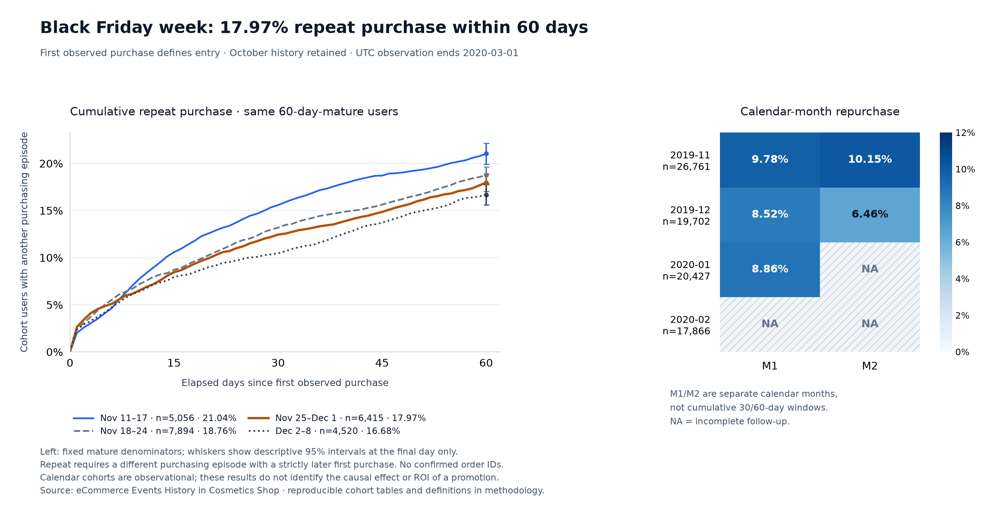
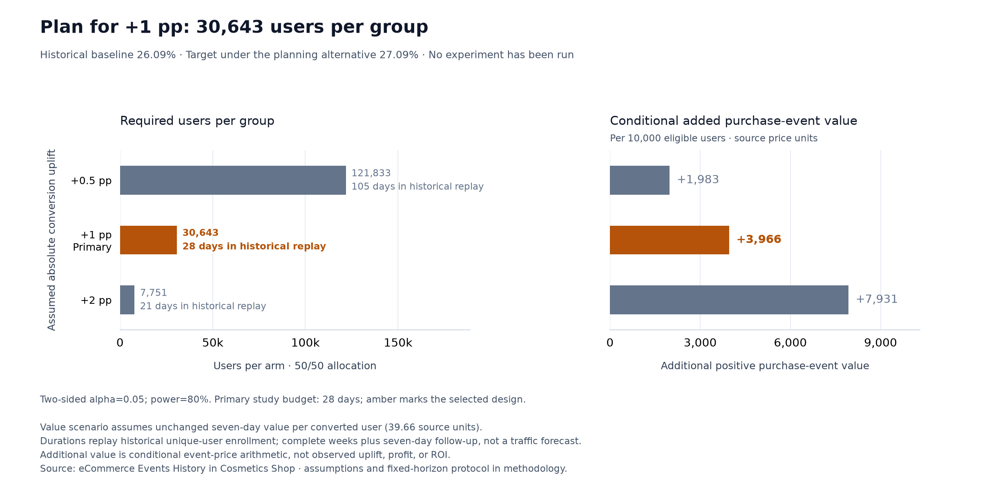

# From Cart to Repeat Purchase

Product analytics of a cosmetics store: purchase funnel, cart abandonment, and repeat purchases around Black Friday 2019.

**Funnel result (October–February):** 122,189 of 1,049,303 observed cart episodes contain a subsequent purchase: **11.64%**. Cart abandonment is measured within the observed episode; purchases can occur in later episodes.

**Recommendation to test:** show the complete cost and available fulfillment conditions in the cart before checkout. A conditional +1 percentage-point conversion scenario corresponds to 3,965.74 additional positive purchase-event price units per 10,000 eligible users, assuming unchanged value per converted user. This is a planning scenario, not observed uplift or profit.

**Status: work in progress.** The analytical models, value scenarios, and prospective experiment design are built and validated. The PostgreSQL/Metabase dashboard and final packaging remain pending; no experiment has been run.

## Business question

Where does the observed purchase journey break down, which customer segments deserve investigation, and which product improvement should be tested first?

A second question examines whether customers whose first observed purchase occurred during Black Friday week make repeat purchases at different rates from nearby weekly cohorts over the same 30- and 60-day horizons.

## Planned analysis

- Validate event coverage, duplicates, prices, and session identifiers.
- Build an ordered view → cart → purchase funnel and compare cart abandonment across customer and price segments.
- Measure repeat purchases using complete follow-up windows.
- Estimate incremental revenue under explicit conversion scenarios and design an A/B test for one prioritized hypothesis.
- Present the results in a reproducible Metabase dashboard and a short decision memo.

## Data

[eCommerce Events History in Cosmetics Shop](https://www.kaggle.com/datasets/mkechinov/ecommerce-events-history-in-cosmetics-shop), published by Michael Kechinov / REES46 on Kaggle. The five source files cover October 2019–February 2020, as verified during the input audit. Dataset terms remain those specified by the publisher on Kaggle.

Raw data is not included in this repository. The event schema has no order ID, confirmed item quantity, acquisition cost, or cost of goods. Purchasing episodes are therefore operational order proxies, with ambiguity and sensitivity checks documented below. Abandoned-cart value is not equivalent to recoverable revenue, and observational cohort differences do not establish a causal promotion effect.

## Ordered funnel

The primary unit is an episode within `(user_id, user_session)`, split at inactivity gaps **greater than 30 minutes** across all files. There are 4,810,579 episodes. Equal timestamps are allowed in the primary sequence; strict ordering is a sensitivity check.

| Ordered stage | Episodes | Conversion from the previous stage |
|---|---:|---:|
| Recorded view | 4,501,112 | — |
| Cart at/after a view | 745,696 | 16.57% |
| Purchase at/after that cart | 95,850 | 12.85% |

Across **all** 1,049,303 episodes with a cart, 122,189 have a purchase at/after the first cart (**11.64%**). The remaining 927,114 (**88.36%**) have no such purchase within the observed episode. This denominator includes cart episodes without a qualifying view and differs from the ordered-funnel denominator above.

There are 157,595 purchase-containing episodes in total. Of these, 61,745 (**39.18%**) lack a complete recorded view → cart → purchase chain. Full-funnel completion therefore does not cover all purchasing activity. Strict timestamp ordering yields 95,808 full chains, 42 fewer than the primary rule. Without the 30-minute split, cart-to-purchase conversion is 12.73%, versus 11.64% with the selected episodes; the unit definition changes the estimate.

The analysis includes all observed eligible episodes. At the end of the dataset, 176 episodes may still be open, including 49 counted as abandoned-cart episodes. Abandonment is an observed sequence outcome, not a monetary-loss estimate or a causal explanation.

## Validation

All 20,692,840 source rows remain in staging, with duplicate and quality flags. Events occur on all 152 calendar days from October 1, 2019 to February 29, 2020. The 4,598 events without session identifiers remain in staging and are excluded from episode calculations; none are purchases. Positive purchase-event prices reconcile to 6,351,830.29 source units under both session definitions.

The audit found 1,109,098 excess exact-row copies; only 905 are purchases. Their removal changes the positive purchase-price sum by 0.0561%, reported as sensitivity. Missing brands, category labels, nonpositive prices, and long-lived source tokens are documented in the [methodology](docs/methodology.md).

## Seven-day user funnel

Each user enters at their first observed view across the complete source history. The primary entry cohort starts on **November 1, 2019**, after the October reference period. Outcomes can span sessions, up to and including seven days after entry. Only users with a fully observable deadline enter the denominator; earlier users do not re-enter at a later view.

| Ordered stage | Users | Conversion from the previous stage |
|---|---:|---:|
| First observed view with complete follow-up | 1,140,964 | — |
| Cart within the seven-day window | 169,884 | 14.89% |
| Purchase after that cart, within the same window | 49,385 | 29.07% |

There are 68,459 users whose first-view window is incomplete and 41,604 observed users without a view; neither group is counted as a failed funnel conversion. The result describes the first observed view cohort, not confirmed new customers. Its population, unit, and horizon differ from the episode funnel, so the conversion rates do not measure a causal benefit of a longer window.

Overall seven-day view-to-purchase conversion is **4.33%**. The separate full-history sensitivity includes 1,529,295 mature users and 68,921 full chains (4.51%); the October entry population accounts for the difference.

## Cart conversion by segment

For **807,560 cart episodes starting in November–February**, 99,078 contain a subsequent purchase. Visitor status uses the user's past observed activity, including October. Entry price uses positive prices of unique products at the first cart timestamp; October-only terciles fix the boundaries at **3.00** and **6.03** source units. Missing positive entry prices remain a separate Unknown group.


The two planned comparisons use user-clustered analytical intervals, retaining covariance when the same user appears in both groups. Bonferroni correction covers the two comparisons together at family alpha 0.05.

| Planned comparison | Difference | Adjusted contrast interval (97.5%) |
|---|---:|---:|
| Returning minus first observed | −0.97 pp | [−1.19, −0.75] pp |
| High minus low entry price | +4.30 pp | [+4.07, +4.53] pp |

These associations identify questions to investigate; they do not show that raising prices improves conversion or explain why returning visitors convert less often. Group user counts overlap. The 52 potentially open cart episodes remain included. See the [methodology](docs/methodology.md#segments-and-statistical-comparisons) for estimands, price rules, uncertainty assumptions, and limits.

## Repeat purchases and Black Friday

A repeat purchase requires a **different purchasing episode beginning strictly after the user's first observed purchase**. Multiple item rows, duplicates, and later purchase rows within the initial episode are not repeat orders. October purchasers do not re-enter later first-purchase cohorts.

The main 30/60-day comparison uses the **same users with complete 60-day follow-up**. The November first-purchase cohort has 14.60% repeat purchase by day 30 and 20.25% by day 60 (n=26,761); December has 10.29% and 15.91% (n=19,702). January and February have no complete 60-day windows and receive no primary 60-day rate.



| First observed purchase | Users | Repeat by 30d | Repeat by 60d | 60d value/user: mean | Median |
|---|---:|---:|---:|---:|---:|
| Nov 11–17 | 5,056 | 15.59% | 21.04% | 51.48 | 32.39 |
| Nov 18–24 | 7,894 | 13.19% | 18.76% | 52.27 | 34.98 |
| Nov 25–Dec 1: Black Friday week | 6,415 | 12.46% | 17.97% | 48.27 | 32.43 |
| Dec 2–8 | 4,520 | 10.46% | 16.68% | 47.19 | 29.83 |
| Nov 29 only: sensitivity | 1,468 | 10.42% | 16.62% | 46.17 | 32.81 |

Value is the sum of positive purchase-event prices in source units, **including the initial purchase**, per eligible buyer. It is not confirmed net sales or profit. The November 29 sensitivity overlaps Black Friday week and cannot be added to it. Calendar M1/M2 cells count repurchase in separate calendar months; they are not cumulative 30/60-day rates.

The Black Friday week's observed 60-day repeat rate is below both preceding weeks, with a descriptive 95% interval of **17.03%–18.91%**. Excluding users with overlapping purchase spans changes that cohort's rate by only **0.013 percentage points** (one cohort member removed). Customer mix, seasonality, unknown discounts, and missing costs prevent a causal promotion-effect or ROI conclusion.

## Prospective experiment: post-cart baseline

The selected hypothesis is to show the complete cost and available fulfillment conditions in the cart before checkout, without a discount. The source does not show the existing interface or why users leave; this is a proposed intervention, not an established cause.

The historical baseline enrolls each user once at their first valid cart in November–February, including those with October cart history. Of 292,094 cart users, **277,852 have complete seven-day follow-up**; 72,498 purchase within the window: **26.09%** (descriptive 95% interval **25.93%–26.26%**). The 14,242 incomplete windows are excluded from the rate, not counted as failures. Strict timestamp ordering changes only two conversions.

Mean positive purchase-event value within the window is **10.35 source units per eligible user**, with median zero. Among converted users, the mean is 39.66. These values can include several purchasing episodes and are not average order value. This baseline differs from both the episode conversion and the first-view user funnel.

The planned test uses user-level assignment, 50/50 allocation, one primary outcome, two-sided alpha 0.05, and power 0.80. The selected planning MDE is **+1 percentage point**, from 26.09% to 27.09% (+3.83% relative). It requires **30,643 users per group**, or 61,286 in total. The educational four-week study budget allows 21 enrollment days and seven follow-up days; the historical replay meets that budget. Actual future enrollment must be checked before launch.

| Assumed absolute uplift | Users per group | Full cycle in historical replay | Added positive purchase-event value per 10,000 users |
|---|---:|---:|---:|
| +0.5 pp | 121,833 | 105 days | 1,982.87 |
| **+1 pp: primary** | **30,643** | **28 days** | **3,965.74** |
| +2 pp | 7,751 | 21 days | 7,931.49 |



The value scenario holds the seven-day positive purchase-event value per converted user at 39.6574 source units. It estimates conditional arithmetic, not realized uplift, recoverable abandoned-cart value, profit, or ROI. The primary MDE is justified by study resources; the dataset cannot identify an economic break-even threshold.

Freeze the planned enrollment and follow-up windows before the experiment. Analyze all eligible assigned users once (intention to treat), including users who do not later see the cart block. Report the effect and its interval; a statistically nonsignificant result is not proof of no useful effect. The proposed tracking and guardrails are described in the [experiment protocol](docs/methodology.md#prospective-protocol-and-conditional-value-scenarios).

## Stack

Current: Python 3.12, uv, DuckDB, NumPy/SciPy for clustered comparisons, and matplotlib for exported figures. Dependency versions are recorded in `uv.lock`.

Planned: PostgreSQL and Metabase/Docker Compose for reporting.

## Documentation

- [Methodology and metric definitions](docs/methodology.md)

## Reproduction

Install uv and run the following commands from the repository root. Manual environment activation is not required.

```powershell
uv sync --locked
uv run --locked python -m unittest discover -s tests -v
```

Download the dataset from Kaggle using **Download** (sign in if required). Create the local input directory and extract the five CSV files directly into it:

```powershell
New-Item -ItemType Directory -Force -Path data/raw
```

```text
data/raw/
  2019-Oct.csv
  2019-Nov.csv
  2019-Dec.csv
  2020-Jan.csv
  2020-Feb.csv
```

The extracted files total approximately 2.43 GB according to Kaggle file metadata. Do not rename the files or place them inside an additional archive subfolder. Raw data, local reports, credentials, and database files are excluded from version control.

After extraction, run the single-file audit:

```powershell
uv run --locked python src/audit_data.py --input data/raw/2019-Oct.csv
```

The audit checks the header, counts every parsed row, reports event types, UTC timestamp bounds and daily coverage, missing fields, invalid timestamps/prices, zero and negative prices, and unexpected event types. It records the input SHA-256, file size, and runtime versions in `data/reports/2019-Oct_audit.json`. CSV structure errors stop the audit instead of silently skipping rows.

To reproduce the full five-file audit, including duplicate sensitivity:

```powershell
foreach ($month in @('2019-Oct', '2019-Nov', '2019-Dec', '2020-Jan', '2020-Feb')) {
    uv run --locked python src/audit_data.py --input "data/raw/$month.csv" --duplicates
    if ($LASTEXITCODE -ne 0) { throw "Audit failed: $month" }
}
```

All source columns are initially read as strings; parsing failures are counted separately. Exact duplicates match all nine original fields, excluding file metadata. `--duplicates` adds a read-only sensitivity calculation; it does not remove any rows. Larger groupings may use temporary disk space in `data/processed/audit_tmp/` under the 1 GB DuckDB memory limit. All five files were audited; detailed JSON reports remain local. This is the audit step, not the complete analytical pipeline.

Build staging, then episodes and funnels:

```powershell
uv run --locked python src/build_staging.py
uv run --locked python src/build_funnel.py
uv run --locked python src/build_analysis.py
uv run --locked python src/build_cohorts.py
uv run --locked python src/build_experiment.py
uv run --locked python src/plot_segments.py
uv run --locked python src/plot_cohorts.py
uv run --locked python src/plot_experiment.py
```

These commands populate `data/processed/shop.duckdb`; local reports are `data/reports/staging_build.json`, `data/reports/funnel_build.json`, `data/reports/user_analysis.json`, `data/reports/cohort_analysis.json`, and `data/reports/experiment_baseline.json`. The plotting commands export the figures above from validated reports. The builds use transactions and record input provenance or staging/table fingerprints. The default memory limit is 1 GB with two worker threads; temporary files stay in `data/processed/shop_tmp/`. A successful staging rebuild invalidates downstream funnel/user/segment/cohort/experiment tables; a funnel rebuild invalidates cart segments and cohorts. Rerun downstream builders and plots after the corresponding upstream rebuild.

The analysis parameters are in `config/analysis.toml`. `episode_events` maps eligible source records to episodes; `episodes` is the primary per-episode view; `session_funnel` stores per-unit results for both session definitions; `funnel_summary` contains counts and rates for both timestamp rules. The original `sessions` table remains the source-key diagnostic baseline.

`users` retains observed activity history even when session keys are missing. `user_funnel` stores fixed-window outcomes and eligibility flags; `user_funnel_summary` separates timestamp rules and entry populations. `cart_entry_prices` and `price_thresholds` establish entry prices and reference-only cutpoints; `cart_segments` stores episode classifications, `cart_segment_users` supplies cluster counts, and `cart_segment_summary` contains reconciled group totals. Statistical estimates and planned contrasts are saved in the analysis JSON report.

`purchase_events` retains purchase records; `purchase_episodes` groups them into order proxies, and `buyer_history` anchors first and strictly later episodes. `buyer_outcomes` stores horizon maturity and outcomes. `cohort_definitions`/`cohort_memberships` define entry groups; `cohort_summary`, `cohort_curves`, and `monthly_repurchase` supply reporting outputs, with counts, values, descriptive intervals, and ambiguity sensitivity in the cohort report.

`cart_experiment_users` anchors the historical post-cart baseline once per user; `cart_experiment_summary` retains both timestamp rules, and `cart_experiment_daily` counts unique historical enrollments. `experiment_scenarios` preserves the prospective calculations for reporting. The experiment report also records the selected design, budget feasibility, and conditional value assumptions. Rebuild it after staging changes; it does not depend on session or cohort tables.

All builders have run on the full dataset. The 72 tests cover repeat builds, boundaries, sequence order, rollback, frozen price calibration, shared-user covariance, simultaneous purchases, complete follow-up, calendar versus elapsed-day outcomes, and prospective power calculations checked against binomial simulation.
